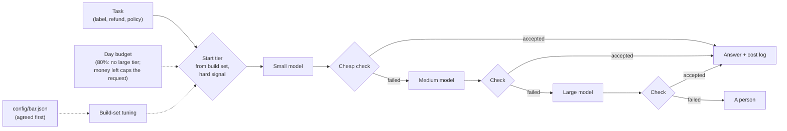

# Architecture

## Components and what each owns

| Component | Layer | Owns |
| --- | --- | --- |
| `domain/tasks.py` | domain | the tasks, the policy text, the refund arithmetic (`refund_cents`) |
| `domain/checks.py` | domain | parsing a label, an amount or a quote; ground-truth grading (`is_correct`); the checks the router can run without the answer key |
| `domain/routing.py` | domain | the router configuration, the day budget, `Attempt` and `Decision`, the agreed bars |
| `domain/pricing.py` | domain | the dated price table and the cost of a call from billed tokens |
| `domain/signals.py` | domain | the difficulty signal visible before any call (two order ids, an exception word) |
| `domain/metrics.py` | domain | rates with Wilson intervals, cost per correct answer with a bootstrap interval, false-accept and false-reject rates |
| `application/tiers.py` | application | the prompt of each task kind, the call to a tier, its cost, the estimate before the call |
| `application/answer_checks.py` | application | which check runs for which kind (the label agreement check calls the model again) |
| `application/router.py` | application | the cascade: start tier, check, escalate, per-request cap, day budget |
| `application/experiments.py` | application | measuring models and checks, tuning from the build set, routing the test set, the day replay, the audit and the one change |
| `infrastructure/llm/*` | infrastructure | the recorded adapter and recording wrapper, the OpenAI-compatible adapter (ollama, llama.cpp, hosted), the Anthropic adapter, retry with backoff |
| `interfaces/cli.py`, `wiring.py` | interfaces | sub-commands, exit codes, the composition root |
| `java/` | separate program | the same study on Spring AI, reading the same files |

The pattern is **ports and adapters**. It fits because a router is a policy over interchangeable models: the tier names are the only thing the cascade knows, and the same code runs against recorded fixtures, three local models or three Claude models by changing the adapter and the model ids.

## Data flow

Drawn versions of this figure and of the walk-through: [the architecture](docs/diagrams/architecture.svg) and [one run](docs/diagrams/flow.svg).

One task through `CostRouter.route`:

1. `config.start_index(kind, hard_signal(task))` gives the first tier: the build set decided where each kind starts (config/router.json), and a hard-looking task may start one tier higher.
2. The day's rule narrows the allowed tiers: at 80% of the budget the largest tier is dropped.
3. Before each call the router adds the call's estimated cost (and its check's, for the label agreement check) to what the request has spent, and compares with the smaller of the per-request cap and what is left of the day's budget. Over the limit: stop and tag the decision `cap` or `budget`.
4. The tier answers; the billed tokens and the price table give the cost.
5. The check for the task's kind runs on the answer (label: allowed word that a second sample repeats; refund: recomputed by code; policy: the quoted line exists).
6. A pass returns the answer and the decision (tiers tried, check results, costs). A fail tries the next tier. When the tiers or the money are used up, the task goes to a person.

## Decisions and trade-offs

- **The bars are written down before any model answers** ([ADR 0002](docs/adr/0002-agree-the-bars-before-the-results.md)), so "a check is too lenient" is a number agreed in advance, not a judgment made after seeing the scores.
- **A check is measured against the truth before it is trusted** ([ADR 0003](docs/adr/0003-measure-every-check-against-the-truth.md)). Grading (`is_correct`) and checking (`check_*`) are separate functions, because the whole point is that they can disagree.
- **The cap is enforced before the call, from an estimate that errs high, and verified after, from billed tokens** ([ADR 0004](docs/adr/0004-enforce-the-cap-before-the-call.md)).
- **The day's budget narrows tiers; the remaining money also caps each request.** Dropping the large tier at 80% alone let a day end over budget in the first run; the second rule makes "under budget" a guarantee up to the estimate error, at the price of handing more tasks to a person late in the day.
- **Record and replay** ([ADR 0001](docs/adr/0001-record-and-replay-model-calls.md)) and **a Java port that must reproduce the reports** ([ADR 0005](docs/adr/0005-the-java-port-is-a-parity-check.md)).
- **Build set decides, test set judges.** `tune` reads only the 150 build tasks; steps 4 to 6 use only the test tasks.

## Failure modes the lesson teaches, and where the code shows them

| Failure | Where it shows |
| --- | --- |
| A check that verifies shape, not correctness | `label_shape`: 100% false-accept at the small tier; two-sample agreement does not fix a consistent bias |
| A check with no power over wrong-but-plausible answers | `policy_quote`: it accepts any real policy line, including the wrong one (5 false accepts at the large tier on the test set) |
| A bigger model that is worse on a kind | step 1: on refunds the large model scores 14%, the medium 36% |
| A cascade that spends more than a single model | step 5: 38 of 150 tasks escalate to a person after paying for failed tiers, so cost per correct is 14% above the large model alone |
| A budget that ends the day over | the first run of `make day`; fixed by the remaining-money limit |
| A replacement check that costs recall | step 6: the overlap check cuts false accepts from 5 to 3 and accuracy from 71.3% to 66.7% |

## Limits of the teaching build against a production one

- Three small local models and illustrative prices; a production router measures real prices, latency and rate limits too.
- Tasks come from templates; real traffic has a long tail the build set cannot cover. A production router re-measures its checks on live traffic and alerts when a tier's accepted-error rate drifts.
- The router is sequential and in-process. A service would add a queue, per-tenant budgets (the gateway project) and a circuit breaker.
- Escalation to a person is a label in a log, not a ticket.

## How to extend it

- A fourth tier: add its name to `domain/pricing.py::TIERS`, a model id to `.env`, a price to `config/prices.json`, then `make record`.
- A new check: add a function to `domain/checks.py`, select it in `AnswerChecks.check`, add a name to `CHECK_NAMES`; `make checks` measures it next to the others.
- A learned difficulty signal: replace `domain/signals.py::hard_signal` with a classifier trained on the build set only, and compare it on the test set.
